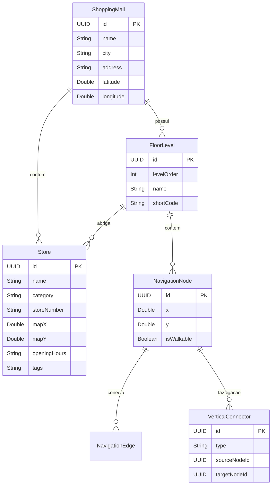

# Especificação do MVP - ShoppingMaps 🗺️🛍️
*"O Waze para Shoppings e Ambientes Fechados"*

Este documento define o escopo, arquitetura de dados, fluxo de usuário e cronograma de implementação do **MVP (Minimum Viable Product)** do **ShoppingMaps**.

---

## 1. Proposta de Valor e Diferenciais
Ao contrário de mapas convencionais que perdem precisão dentro de edifícios, o **ShoppingMaps** oferece:
- **Visualização Indoor de Alta Fidelidade**: Deep zoom contínuo para navegar por corredores estreitos, visualizar quiosques, lojas e comodidades com clareza cristalina.
- **Consciência de Andares (Floor Awareness)**: Alternância suave entre múltiplos pisos (Subsolos, Térreo, Andares Superiores).
- **Roteamento Turn-by-Turn em Corredores**: Linha de rota desenhada exatamente sobre os caminhos caminháveis, orientando o usuário em conexões verticais (escadas rolantes e elevadores).
- **Descoberta Rápida**: Busca instantânea por lojas, produtos e comodidades vitais (banheiros, fraldários, caixas eletrônicos e saídas).

---

## 2. Escopo do MVP (Versão 1.0)

### Funcionalidade 1: Seleção de Shopping (Mall Hub)
- Tela inicial com lista de shoppings cadastrados (com fotos, quantidade de lojas e andares).
- Ao selecionar, o app baixa/carrega instantaneamente o mapa vetorial e catálogo de lojas offline (SwiftData).

### Funcionalidade 2: Mapa Indoor Interativo com Deep Zoom
- Canvas vetorial com renderização a 60/120fps.
- Gestos fluidos de pinça para zoom (`MagnifyGesture`) e arrasto (`DragGesture`).
- Seletor vertical flutuante de andares no canto da tela (ex: `SS`, `T`, `L1`, `L2`).
- Rótulos inteligentes com Nível de Detalhe (LOD): lojas menores aparecem conforme o usuário aproxima o zoom.
- Pino da posição do usuário (com simulação de caminhada e toque para definir ponto de partida).

### Funcionalidade 3: Catálogo e Detalhes da Loja (Store Sheet)
- Toque em qualquer loja no mapa ou item da busca.
- Bottom Sheet nativo do iOS com:
  - Nome da loja, ícone/categoria, piso.
  - Horário de funcionamento e descrição.
  - Botão de ação primária: **"Como Chegar" / "Traçar Rota"**.

### Funcionalidade 4: Busca Inteligente & Acesso Rápido
- Barra de pesquisa integrada com autocomplete.
- Chips de acesso rápido a utilidades essenciais:
  - 🚻 Banheiros mais próximos
  - 🍔 Praça de Alimentação
  - ☕ Cafeterias
  - 🏧 Caixas 24h
  - 🅿️ Acesso ao Estacionamento

### Funcionalidade 5: Motor de Rotas Indoor (Turn-by-Turn)
- Traçado da rota luminosa estilizada sobre a malha de corredores.
- Algoritmo A* (A-Star) para menor caminho.
- Suporte a rotas entre pisos diferentes com indicação da escada rolante ou elevador mais próximo.
- Card superior estilo Waze indicando a próxima ação: *"Siga 40m em frente e vire à direita na Livraria"*.

---

## 3. Modelo de Dados (SwiftData)

---

## 4. Fases de Execução do MVP

| Fase | Foco de Entrega | Componentes Principais |
| :--- | :--- | :--- |
| **Fase 1** | **Fundação de Dados & Seed** | Modelos SwiftData (`ShoppingMall`, `Store`, `FloorLevel`, `NavigationGraph`) e Mock de dados com shopping realista de 3 andares. |
| **Fase 2** | **Motor de Mapa & Deep Zoom** | `IndoorMapView.swift`, gestures de pan/zoom, seletor de pisos e renderização vetorial de corredores e lojas. |
| **Fase 3** | **Busca & Detalhes da Loja** | Barra de busca com autocomplete, bottom sheet interativo com detalhes e categorias. |
| **Fase 4** | **Motor de Rotas Indoor (A*)** | Cálculo de rota com A*, polyline dinâmica desenhada no mapa e cards de navegação estilo Waze. |
| **Fase 5** | **Polimento & Testes** | Feedback háptico, transições animadas, testes de unidade com Swift Testing e validação de performance. |

